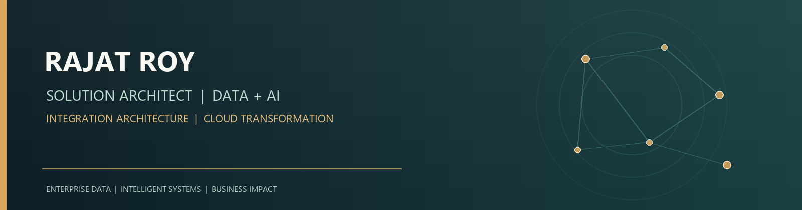

  

<h1 align="center">Rajat Roy</h1>

  <strong>Solution Architect | Data &amp; AI | Integration Architecture</strong> 
  Building secure, scalable data ecosystems and modernizing enterprise operations.

  
  
  
  

---

## 🏢 Experience

### Solution Architect · Takeda Pharmaceuticals
**September 2026 – Present**  
Working with Data and AI to shape practical, business-aligned solutions.

### Associate Consultant · Tata Consultancy Services
**November 2010 – October 2026**  
Delivered solutions across the insurance domain, spanning Data & AI and Integration Architecture.

---

## 🧭 Professional Profile

I work at the intersection of enterprise architecture, data engineering, and AI. My experience includes insurance transformation across claims, policy administration, underwriting, and billing, with a focus on cloud data platforms, real-time pipelines, automation, and governed solutions.

My portfolio highlights global delivery experience across India, the UAE, South Africa, and the UK, along with 12+ professional certifications and industry recognitions.

---

## 🧰 Technology Stack

**Cloud & Data Platforms**  

**Engineering & Streaming**  

**AI, Integration & Operations**  

---

## 🚀 Selected Projects

- 🛡️ [Insurance Fraud Detection on Databricks](https://github.com/roy777rajat/insurance-fraud-databricks-hackathon) — Lakehouse-based data engineering with machine learning and BI.
- 🧠 [FamilyVault AI](https://github.com/roy777rajat/familyvault-ai) — Secure document intelligence using AWS and retrieval-augmented generation.
- 💹 [Personal Finance Dashboard](https://github.com/roy777rajat/databricks-finance-dashboard) — Databricks, Lakebase, Unity Catalog, and Streamlit.
- 🏠 [Databricks Home Lab](https://github.com/roy777rajat/databricks-home-lab) — Cost-aware cloud infrastructure and Databricks experiments.

## ✍️ Articles & Project Notes

- [Real-Time Motor Insurance Fraud Detection with Databricks Lakehouse](https://medium.com/@uk.rajatroy/real-time-motor-insurance-fraud-detection-system-using-databricks-lakehouse-55fac8952777)
- [AI-Powered Defect Workflow with MCP, n8n, and messaging integrations](https://medium.com/@uk.rajatroy/the-ai-powered-defect-workflow-state-machine-mcp-meets-n8n-render-and-whatsapp-slack-3ad8c936b944)
- [Insurance Product Media Maker with Agentic AI](https://medium.com/@uk.rajatroy/insurance-product-media-maker-agentic-ai-with-llms-multi-agent-orchestration-mcp-and-media-92840d27806c)
- [Explore more articles on Medium](https://medium.com/@uk.rajatroy)

---

## 🏅 Certifications & Recognition

AWS Solutions Architect · Databricks Data Engineering · Databricks Platform Architect · Confluent Data Streaming · Neo4j

Recognized in the **AI Magic with AWS Q Innovation Challenge 2025** and the **Redis AI Challenge**. See [my portfolio](https://www.rajatwork.com/) for certification details.

---

## 🌐 Find Me Online

- 🌍 [Portfolio & professional services](https://www.rajatwork.com/)
- 💼 [LinkedIn](https://www.linkedin.com/in/royrajat/)
- ✍️ [Medium articles](https://medium.com/@uk.rajatroy)
- 🧑‍💻 [GitHub projects](https://github.com/roy777rajat)
- 📧 [Email](mailto:roy777rajat@gmail.com)

<em>Transforming insurance operations with Data + AI: from claims automation to policy insights, building secure and scalable solutions.</em>
