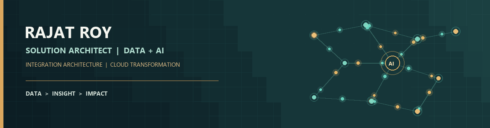

  

  
  
  

  

<h1 align="center">Rajat Roy</h1>

  <strong>Solution Architect | Data &amp; AI | Integration Architect</strong> 
  Building secure, scalable data ecosystems and modernizing enterprise operations.

  
  
  
  

---

## 🏢 Experience

| Organization | Role | Period |
| --- | --- | --- |
| Takeda Pharmaceuticals | Solution Architect | Sep 2026 – Present |
| Tata Consultancy Services | Associate Consultant | Nov 2010 – Oct 2026 |
| Cognizant Technology Solutions | Technical Analyst | Mar 2010 – Nov 2010 |
| Bennett, Coleman and Co. Ltd. (Times Group) | System Engineer | Nov 2007 – Mar 2010 |

---

## 🧭 Professional Profile

**Data can be chaotic. The experience shouldn’t be.** I turn complexity into useful insight with Data + AI, then make the journey from first question to next best action feel effortless.

---

## 🧰 Technology Stack

**Cloud & Data Platforms**  

**Engineering & Streaming**  

**AI, Integration & Operations**  

---

## 🚀 Selected Projects

All 19 owned public project repositories are listed below; forks and this profile repository are excluded. Select a linked project name to open its repository. Live URLs appear only where a public app or demo is documented. `Not published` means no public live URL was listed in the repository.

📡 Data Platforms & Streaming (7 projects)

| Tech domain | 🔗 Project link | Description | Live link | Tech stack |
| --- | --- | --- | --- | --- |
| ✈️ Aviation & serverless data | [AviationStack](https://github.com/roy777rajat/aviationstack) | Scheduled flight-status ingestion and email notifications using AWS serverless services. | Not published |    |
| ☁️ Cloud networking | [Databricks Home Lab](https://github.com/roy777rajat/databricks-home-lab) | Cost-optimized AWS customer-managed VPC design for Databricks workloads. | Not published |   |
| 📚 Data engineering resources | [Databricks-Top](https://github.com/roy777rajat/Databricks-Top) | Databricks code and learning resources; repository detail is limited. | Not published |   |
| 🔄 Change data capture | [Debezium PostgreSQL Kafka](https://github.com/roy777rajat/debezium-postgres-kafka) | PostgreSQL CDC examples with Debezium and Kafka, plus a test-data utility. | Not published |    |
| ✈️ Aviation analytics | [Kafka Airflight Data](https://github.com/roy777rajat/Kafka-Airflight-Data) | Flight-data streaming from Kafka to AWS storage and analytics, with Grafana visualization. | [Video demo](https://youtu.be/KlBnCynSdeo) |    |
| 🌊 Stream processing | [Kafka PySpark Streaming](https://github.com/roy777rajat/Kafka-PySpark-Streaming) | Kappa-style CDC pipeline processing Kafka events to PostgreSQL and Delta Lake. | [Video demo](https://youtu.be/e5MuRS6tDaw) |    |
| 🏏 Sports data streaming | [Live Cricket Data](https://github.com/roy777rajat/stream-cricket-live-data) | Streaming prototype for cricket live-score data, with Kinesis extraction notebooks. | Not published |   |

🏦 Insurance & Financial Platforms (3 projects)

| Tech domain | 🔗 Project link | Description | Live link | Tech stack |
| --- | --- | --- | --- | --- |
| 🏦 Insurance data engineering | [AWS DMS Insurance Pipeline](https://github.com/roy777rajat/aws-dms-pipeline) | Cost-aware insurance analytics pipeline using continuous database replication and Lakehouse processing. | Not published |    |
| 💹 FinTech & Lakehouse apps | [Personal Finance Dashboard](https://github.com/roy777rajat/databricks-finance-dashboard) | Streaming transaction ingestion, medallion transformations, Lakebase serving, and a Streamlit dashboard. | Databricks App; workspace URL not listed |     |
| 🏦 Insurance analytics & ML | [Insurance Fraud Detection](https://github.com/roy777rajat/insurance-fraud-databricks-hackathon) | Databricks Lakehouse pipeline that scores motor claims and supports investigator analysis. | Databricks dashboard; workspace URL not listed |    |

🤖 AI, Automation & Decision Support (6 projects)

| Tech domain | 🔗 Project link | Description | Live link | Tech stack |
| --- | --- | --- | --- | --- |
| 🤖 AI & knowledge search | [AI Document Repository](https://github.com/roy777rajat/ai-document-repo) | Semantic search over documents stored in AWS S3, with Redis-backed retrieval. | Not published |    |
| ☁️ Cloud & agent integration | [AWS MCP Server](https://github.com/roy777rajat/AWS-MCP-SERVER) | MCP/JSON-RPC service connecting AI clients to AWS operations and observability tools. | Render deployment documented; URL not listed |     |
| 🛡️ Public safety & computer vision | [CrowdGuard AI](https://github.com/roy777rajat/crowdguard-ai) | Crowd-safety decision support with camera-based people counting, incidents, forecasting, and an AI assistant. | Not published |     |
| 📄 AI document intelligence | [FamilyVault AI](https://github.com/roy777rajat/familyvault-ai) | Secure document storage, semantic retrieval, and AI-assisted Q&A for family documents. | [Open app](https://d38ys5d9amc45p.cloudfront.net/app/index.html) |    |
| 🧠 Insurance AI agents | [Insurance Agent Lab](https://github.com/roy777rajat/insurance-agent-lab) | Modular insurance and media workflows using agent routing, generation tools, and Bedrock guardrails. | Not published |    |
| 🧰 Agentic workflow APIs | [MCP Defect Assistant API](https://github.com/roy777rajat/mcp-defect-assistant-api) | MCP API for defect-management workflows, with a Render deployment configuration. | Render deployment configured; URL not listed |     |

🧩 Web & Application Prototypes (3 projects)

| Tech domain | 🔗 Project link | Description | Live link | Tech stack |
| --- | --- | --- | --- | --- |
| 🖥️ Web development | [CloudForge Portfolio](https://github.com/roy777rajat/cloudforge-portolio) | React-based portfolio site built with Vite, TypeScript, and Tailwind CSS. | Not published |     |
| 🎮 Games | [Tennis Game](https://github.com/roy777rajat/gamechallenger) | Python tennis game with single-player AI, local multiplayer, and difficulty settings. | Not published |   |
| 📷 Cloud app deployment | [My Photo App](https://github.com/roy777rajat/my_photo_app) | Python application repository with AWS EC2 and CodeDeploy automation artifacts; project details are limited. | Not published |    |

## ✍️ Articles & Project Notes

- [Real-Time Motor Insurance Fraud Detection with Databricks Lakehouse](https://medium.com/@uk.rajatroy/real-time-motor-insurance-fraud-detection-system-using-databricks-lakehouse-55fac8952777)
- [AI-Powered Defect Workflow with MCP, n8n, and messaging integrations](https://medium.com/@uk.rajatroy/the-ai-powered-defect-workflow-state-machine-mcp-meets-n8n-render-and-whatsapp-slack-3ad8c936b944)
- [Insurance Product Media Maker with Agentic AI](https://medium.com/@uk.rajatroy/insurance-product-media-maker-agentic-ai-with-llms-multi-agent-orchestration-mcp-and-media-92840d27806c)
- [Explore more articles on Medium](https://medium.com/@uk.rajatroy)

---

## 🏅 Certifications & Recognition

AWS Solutions Architect · Databricks Data Engineering · Databricks Platform Architect · Confluent Data Streaming · Neo4j

Recognized in the **AI Magic with AWS Q Innovation Challenge 2025** and the **Redis AI Challenge**. See [my portfolio](https://www.rajatwork.com/) for certification details.

---

## 🌐 Find Me Online

- 🌍 [Portfolio & professional services](https://www.rajatwork.com/)
- 💼 [LinkedIn](https://www.linkedin.com/in/royrajat/)
- ✍️ [Medium articles](https://medium.com/@uk.rajatroy)
- 🧑‍💻 [GitHub projects](https://github.com/roy777rajat)
- 📧 [Email](mailto:roy777rajat@gmail.com)

<em>Transforming insurance operations with Data + AI: from claims automation to policy insights, building secure and scalable solutions.</em>
